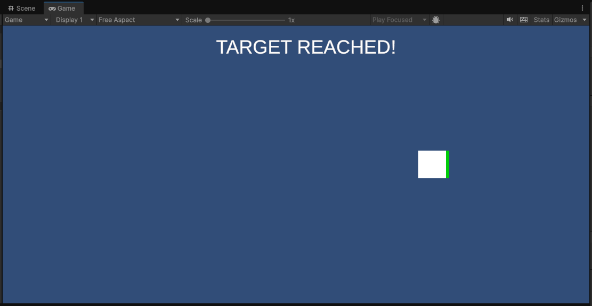
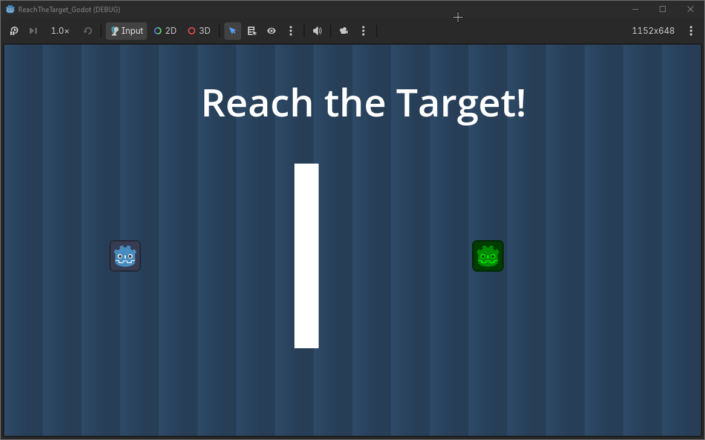

# FDJ-S4-ReachTheTarget

## Engine

- `Godot 4 .NET (4.7.2)` - versão tutorial + implementação de melhorias
- `Unity 6.3 LTS (6000.3.27f1)` - versão tutorial

## Estrutura do repositório

- Unity: [Unity/](Unity/)
- Godot: [Godot/](Godot/)
- Screenshots: [screenshots/](Screenshots/)
- Comparação dos Engine: [Comparação.md](Docs/Comparação.md)
- Reflexão Final: [ReflexãoFinal.md](Docs/ReflexãoFinal.md)

## Documentação Extra

- GitHub Project: [Reach The Target - Dev](https://github.com/users/adr-g/projects/2)

## Objetivo

O objetivo foi o desenvolvimento de um jogo 2D onde o jogador se movimenta até alcançar um alvo, recebendo uma mensagem de sucesso.

## Como executar

- **Unity 6.3 LTS:** Projeto em `Unity/ReachTheTarget_Unity/`, cena principal `Assets/Scenes/Main.unity`.
- **Godot 4.7.2 .NET:** Projeto em `Godot/ReachTheTarget_Godot/`, com a cena principal configurada para execução direta (F5).

## Protótipos

| Unity                                                      | Godot                                                |
| ---------------------------------------------------------- | ---------------------------------------------------- |
|  |  |

## Controlos

- `Unity` - WASD ou setas.
- `Godot` - WASD ou setas, R.

## Funcionalidades

- Movimento
- Colisão
- Targets
- Feedback

## Melhorias implementadas

1. Fundo do cenário (Starter): criação de um fundo com gradiente, sem utilização de recursos externos.
2. Obstáculo (Explorer): implementação de uma barreira física.
3. Reiniciar jogo (Developer): implementação da tecla R para reiniciar a cena através de C#.

## Autor

- `Guilherme Andrade`
- `A045395`
- [@adr-g](https://github.com/adr-g)
